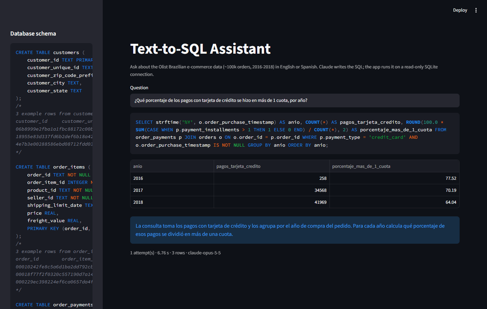
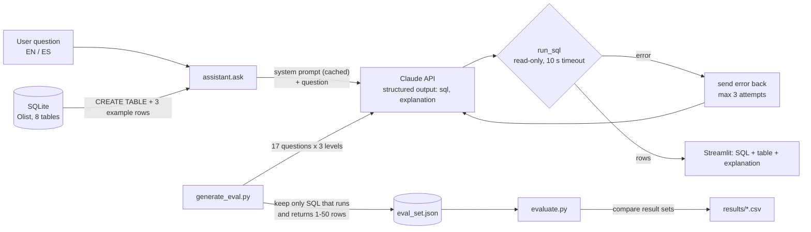

# Text-to-SQL Assistant with Evaluation

Ask business questions in **English or Spanish** about a real e-commerce database and get back the SQL, the result table and a short explanation. Claude writes the query, the app runs it on a read-only SQLite connection, and if the query fails the error is sent back to Claude so it can fix it.

The project also includes the part that matters most in AI engineering: a **benchmark generated with Claude, validated automatically, and an evaluation harness** that measures execution accuracy by difficulty level.



## Architecture



| Module | Responsibility |
|---|---|
| `text2sql/schema.sql` | Tables with primary/foreign keys, indexes and comments that document the data for the model |
| `text2sql/db.py` | Builds the database from the CSVs, renders the schema prompt, runs queries read-only with a timeout |
| `text2sql/llm.py` | The only module that calls the Claude API (model, prompt caching, structured outputs, refusal fallback) |
| `text2sql/assistant.py` | Question → SQL → result, with the self-correction loop |
| `text2sql/generate_eval.py` | Synthesizes the benchmark with Claude and validates every pair by executing it |
| `text2sql/evaluate.py` | Runs the assistant on the benchmark and reports execution accuracy |
| `app.py` | Streamlit UI |

## Design decisions

- **Schema prompt = `CREATE TABLE` statements + 3 example rows per table.** This format performed best in [Rajkumar et al., 2022](https://arxiv.org/abs/2204.00498). Example rows show value formats the DDL can't (Portuguese category names, timestamp format, status values). Comments inside the DDL (e.g. "use `customer_unique_id` to count real customers") are kept by SQLite, so the schema file is the single source of documentation.
- **Structured outputs** (`output_config.format` with a JSON schema) guarantee the response parses into `{sql, explanation}`: no regex over free text.
- **Self-correction loop**: on a database error the assistant appends the error message to the conversation and asks for a fix, up to 3 attempts. The evaluation reports first-try accuracy and final accuracy separately, so the value of the loop is measured, not assumed.
- **Safety at the trust boundary**: generated SQL is untrusted input. The connection is opened with SQLite `mode=ro` (writes are impossible), `execute()` accepts a single statement, and a progress handler aborts queries after 10 s.
- **Prompt caching**: the schema prompt is byte-identical on every call (tables are sorted by name), so it is cached and later calls read it at ~10% of the input price.
- **Execution accuracy** as the metric: two queries are correct if they return the same rows, regardless of how the SQL is written. Rows and columns are compared as multisets with numbers rounded to 2 decimals.
- **Benchmark generated by Claude, filtered by execution**: 17 candidates per level (easy / medium / hard); a pair is kept only if its SQL runs and returns 1-50 rows. About a third of the questions are in Spanish, and several cover payment methods and installment plans.

## Results

51-question benchmark (all 51 generated pairs passed validation), model `claude-opus-5-5`:

| Difficulty | Questions | Execution accuracy | First-try accuracy | Needed a retry | Avg latency |
|---|---|---|---|---|---|
| easy | 17 | 100.0% | 100.0% | 0 | 2.5 s |
| medium | 17 | 100.0% | 100.0% | 0 | 4.5 s |
| hard | 17 | 100.0% | 100.0% | 0 | 5.3 s |
| **overall** | **51** | **100.0%** | **100.0%** | **0** | **4.1 s** |

- **Spanish vs English**: 18/18 Spanish and 33/33 English questions correct.
- **Cost**: about $0.38 for the full 51-question run (under $0.01 per question). 95% of input tokens were served from the prompt cache.
- **The self-correction loop never fired**: every generated query ran on the first try. The loop is covered by unit tests, but this benchmark doesn't exercise it.

### Run history: the first run found a defect in the benchmark

| Run | Benchmark | Overall | Hard |
|---|---|---|---|
| 1 | original wording | 98.0% (50/51) | 94.1% |
| 2 (above) | #28 and #41 reworded, gold SQL unchanged | 100.0% (51/51) | 100.0% |

- **The only miss in run 1 (#41) was an ambiguous question, not a model error.** It asked for "the number of distinct orders" next to their average review score. The gold SQL counted only orders that have a review (inner join: 7,661 late orders); the assistant counted every delivered order (left join: 7,826). Both readings are defensible.
- **Benchmark audit**: after run 1, all 51 gold queries were reviewed against their questions and none was wrong. Two questions were ambiguous about orders without reviews or items: #41 and #28, where 461 orders have no items. Both were reworded to say "only orders that have at least one review / item", leaving the gold SQL unchanged. Two "hard" items are still near-duplicates of "medium" ones (#38 ≈ #23, #48 ≈ #20). No top-N question has a tie at its cut-off.

Per-question results (gold SQL, predicted SQL, attempts, tokens, latency) are in [`results/eval_results.csv`](results/eval_results.csv), with the summary in [`results/summary.csv`](results/summary.csv). Run 1 is kept in [`results/run1_original_wording/`](results/run1_original_wording/).

## How to run

Requires Python 3.10+ and an [Anthropic API key](https://console.anthropic.com/settings/keys).

```bash
python -m venv .venv
source .venv/bin/activate          # Windows: .venv\Scripts\activate
pip install -r requirements.txt
cp .env.example .env               # then paste your key into .env
```

**1. Get the data** - the [Brazilian E-Commerce Public Dataset by Olist](https://www.kaggle.com/datasets/olistbr/brazilian-ecommerce) (CC BY-NC-SA 4.0). Download it from Kaggle, or from Olist's GitHub:

```bash
mkdir -p data/raw && cd data/raw
for f in olist_customers_dataset olist_order_items_dataset olist_order_payments_dataset olist_order_reviews_dataset \
         olist_orders_dataset olist_products_dataset olist_sellers_dataset product_category_name_translation; do
  curl -sSfLO "https://raw.githubusercontent.com/olist/work-at-olist-data/master/datasets/$f.csv"
done
cd ../..
```

**2. Build the database, generate the benchmark, evaluate**

```bash
python -m text2sql.db              # ~20 s, writes data/olist.db
python -m text2sql.generate_eval   # writes data/eval_set.json
python -m text2sql.evaluate        # writes results/eval_results.csv and results/summary.csv
python -m text2sql.evaluate 5      # optional: quick run on the first 5 questions
```

**3. Run the app and the tests**

```bash
streamlit run app.py
pytest                             # no API key or dataset needed
```

## Limitations and next steps

- **Gold SQL is LLM-generated**: it is validated automatically by execution, and was reviewed item by item once (see the benchmark audit above). A larger benchmark would need a second model to judge each pair, since item-by-item review doesn't scale.
- **Same model writes the benchmark and answers it**, which can inflate scores; the questions are also deliberately unambiguous, easier than real user questions. A harder test would use a public benchmark such as [BIRD](https://bird-bench.github.io/) or Spider.
- **The benchmark is saturated.** At 100% it can't show whether a change to the prompt or model is an improvement. The next step is a harder set: underspecified questions, questions that should be refused, and multi-step analyses.
- **51 questions is a small sample**: 51/51 has a 95% confidence interval of roughly 93-100% (Wilson).
- The comparison ignores row order, so "top 5" questions are checked on which rows come back, not their order.
